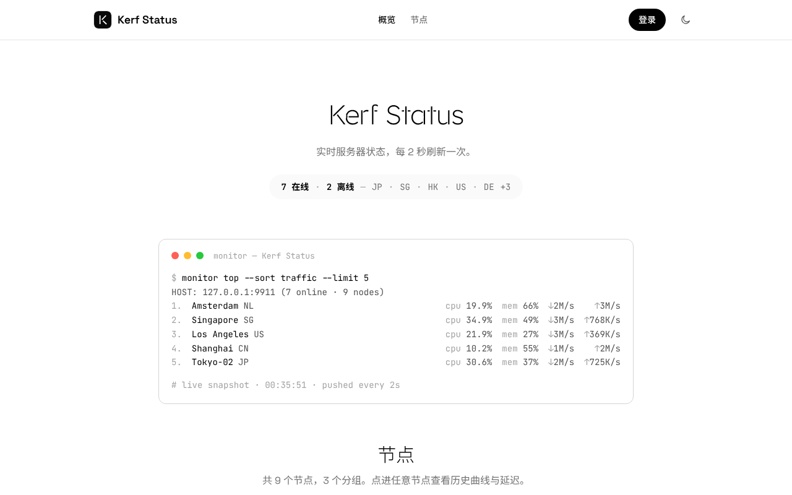

# Kerf

[monitor](https://github.com/monitor-probe/monitor) 的公开状态页主题。黑白极简，标题用一套自制的细线断笔字体：每个笔画在交接处断开一道细缝（kerf，锯缝），节点报告做成终端窗口，节点卡片做成价格卡的样子：价格、CPU / 内存 / 磁盘 / 流量进度条、各线路延迟与丢包。



- 纯静态单页，零依赖：原生 JS + CSS，构建只需 Node.js，整包约 180 KB
- 三套字体随包自带，不请求任何外部 CDN，国内访问不受影响
- 深浅色跟随系统，访客可手动切换（只存在访客自己的浏览器里）
- 以手机为主设计：触控尺寸、安全区、浏览器地址栏配色都照顾到了，平板和桌面同样适配
- 从节点详情返回列表时回到原来的位置

## 安装

三种方式，任选其一（详见文档的[安装与切换](https://monitor-document.pages.dev/dev/theme#安装与切换)）：

1. 面板 **主题** 页填 `https://github.com/wxte/monitor-theme-kerf`，点「从 GitHub 安装」
2. 下载 [Releases](../../releases/latest) 里的 `theme.tar.gz`（不是 Source code），在 **主题** 页上传
3. 解压到 hub 的主题目录：一键脚本部署是 `/opt/monitor/data/themes/kerf/`

装好后在 **主题** 页选中即可，不用重启。

## 路由

| 路径 | 页面 |
| --- | --- |
| `/` | 首页：概览、终端报告、节点列表 |
| `/node/{id}` | 节点详情：实时指标、历史曲线、延迟、节点信息 |

hub 前面如果有按路径放行的反代或 WAF，要放行 `/node/` 前缀，以及 `/fonts/`、`/assets/`、`/favicon.svg`、`/apple-touch-icon.png`。症状是「点进节点正常，一刷新就被拦」。

## 主题设置

在面板 **主题** 页的卡片上点设置按钮即可修改，保存后刷新公开页生效。

| 设置 | 默认 | 说明 |
| --- | --- | --- |
| 大标题 | 空 | 留空显示站点名称 |
| 副标题 | 实时服务器状态，每 2 秒刷新一次。 | |
| 公告 | 空 | 显示在大标题上方，纯文本，可换行 |
| 显示终端报告 | 开 | 首页按实时流量排序的终端式报告 |
| 终端报告行数 | 5 | 1–20 |
| 节点布局 | 卡片 | 卡片 / 列表。列表每行左边是节点名和 CPU、内存、磁盘，中间是前三条延迟线路的当前延迟，右边上下两行是下行、上行速率 |
| 显示价格 | 开 | 有价格的节点在卡片上显示价格和付款周期 |
| 显示延迟 | 开 | 卡片上显示各延迟线路最近 1 小时的折线、当前延迟和丢包率；列表布局显示前三条线路的当前延迟。只请求屏幕上看得到的在线节点，每张卡每分钟一次，最多同时 3 个请求 |
| 国家显示 | 文字 | 文字代码（JP）/ 彩色国旗 / 灰色国旗 |
| 显示规格清单 | 关 | 卡片底部的 ✓ 清单：CPU 型号、内存、磁盘、网速、系统、运行时间、到期日（节点详情里都有） |
| 到期提醒 | 开 | 7 天内到期或已过期时在卡片价格下方提示，到期日期在节点详情里 |
| 页脚说明 | 空 | 页脚只有一行：这段说明（如果填了）加「© 年份 站点名」 |

## 字体

| 字体 | 用途 | 来源 |
| --- | --- | --- |
| Kerf | 大标题、区块标题 | 由 [Lexend](https://github.com/googlefonts/lexend) 派生，`tools/build_kerf.py` 生成 |
| Space Grotesk | 正文、数字 | [floriankarsten/space-grotesk](https://github.com/floriankarsten/space-grotesk) |
| JetBrains Mono | 终端、等宽数字 | [JetBrains/JetBrainsMono](https://github.com/JetBrains/JetBrainsMono) |

国旗来自 [flag-icons](https://github.com/lipis/flag-icons)（MIT），转成了 48×36 的小 PNG：灰度的在 `static/flags/`，彩色的在 `static/flags-color/`，许可证随附。

三套字体都是 SIL Open Font License 1.1，许可证随字体放在 `static/fonts/`。Kerf 是 Lexend 的修改版，按 OFL 要求改了名字。中文回落到系统字体：标题用细体（苹方 Light、微软雅黑 Light 等），和极细的英文笔画相称。

字体只保留了拉丁字符的子集，所以很小。重新生成 Kerf：

```sh
pip install fonttools numpy scipy scikit-image opencv-python pillow
python3 tools/build_kerf.py "path/to/Lexend[wght].ttf" static/fonts 200
```

最后一个参数是字重（100–900），越小越细。

## 开发

不需要 npm，只要 Node.js。

```
src/        页面源码：index.html、app.js、app.css
static/     原样复制的文件：字体、图标
tools/      构建、打包、模拟 hub、字体生成
dist/       构建产物（不进仓库）
```

`node tools/build.mjs` 生成 `dist/`：把 `theme.json` 里的设置默认值写进脚本，并给每个资源文件名加上内容指纹（`app.3f9a1c2b.js`、`kerf.woff?v=…`）。主题更新后访客下次打开页面就拿到新文件，不会被浏览器缓存卡住。

```sh
# 模拟 hub：假数据，带 WebSocket gzip 推送；启动和每次刷新页面时自动构建
node tools/mock-hub.mjs           # 打开 http://127.0.0.1:9911

# 接一个真实 hub 的数据（它要开着公开状态页）
MONITOR_HUB=https://hub.example.com node tools/mock-hub.mjs

# 其它情形
MOCK_CLOSED=1 node tools/mock-hub.mjs   # 公开页关闭（401）
MOCK_NOWS=1 node tools/mock-hub.mjs     # WebSocket 被拒，测试轮询兜底
```

## 发布

1. 改 `theme.json` 的 `version`（比如 `1.0.1`），提交到 main
2. 在 GitHub 仓库页右侧 **Releases → Draft a new release**，tag 填 `v1.0.1`（和 version 对上，前面加 v），点 **Publish release**

`.github/workflows/release.yml` 会自动检查 tag 与 `version` 一致（不一致时面板的一键更新会每次都重装），打包、校验 gzip 尾部，然后把 `theme.tar.gz` 上传到这个 release。也可以直接推送 tag：`git tag v1.0.1 && git push origin v1.0.1`，效果相同。

本地打包：`sh tools/pack.sh`。

## 与数据接口的约定

按 [主题开发](https://monitor-document.pages.dev/dev/theme) 实现，要点：

- 只用同源的 `/api/me`、`/api/nodes`、`/api/nodes/{id}/metrics`、`/api/ws`、`/api/themes/kerf/config`
- `/api/ws?gzip` 收压缩帧，按到达顺序逐帧解压；10 秒没有新帧当作断流重连；连不上（含满额 503）时每 5 秒轮询 `/api/nodes`，并定时重试 WebSocket
- 页面切到后台时断开推送、停止轮询，切回前台立即请求一次并重连
- 到期天数用 `expires_in`、离线时长用 `last_seen_ago`，旧 hub 没有这两个字段时才用浏览器时钟自算
- 节点上报的字符串、分组名、公开备注、主题设置全部按纯文本渲染
- 节点指标缺失或格式不对时只把这个节点当作「不可用」，不影响其它节点
- 分组按节点顺序排列，切换分组时在线数、网速、流量都跟着这一组算；只有部分节点有分组时显示「未分组」
- 时间范围按 `/api/me` 的 `history_days` 生成
- 价格用 `Intl.NumberFormat("zh-CN")` 显示，付款周期支持 `<n>m`

## 许可

代码 MIT，字体 SIL OFL 1.1，国旗 MIT（flag-icons）。
